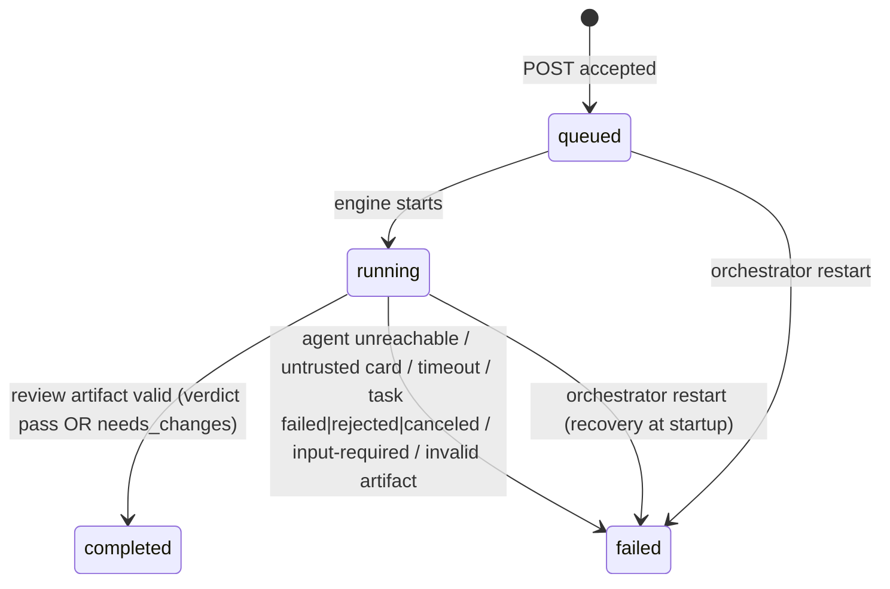

# Architecture (P0)

## Component boundaries

| Component | Owns | Never does |
|---|---|---|
| Astro dashboard | Submission form, history, detail view (static, same origin) | Hold secrets, talk to agents or DB, render agent output as HTML |
| API + orchestrator (`backend/apps/api`) | Request validation, admission control, agent discovery + trust, workflow sequence, timeouts, persistence | Run LLM calls, execute generated content |
| Worker agent (`backend/apps/worker-agent`) | One skill: `draft-answer` | Call the Reviewer, access the DB |
| Reviewer agent (`backend/apps/reviewer-agent`) | One skill: `review-draft` | Call the Worker, access the DB |
| Agent runtime (`backend/crates/agent-runtime`) | SDK server wiring for one `Skill` per agent; the single LLM provider client | Business logic of either agent |
| Postgres (`backend/migrations`) | `workflows`, `agent_runs`, `artifacts` | Be reachable from the browser (RLS enabled, no policies) |

A2A transport: official SDK [`a2aproject/a2a-rs`](https://github.com/a2aproject/a2a-rs)
(`a2a-lf 0.4.2`, `a2a-server-lf 0.5.3`, `a2a-client-lf 0.2.9`, pinned exactly), JSON-RPC 2.0 over HTTP.
Agents publish only a JSON-RPC interface; the orchestrator registers only the JSON-RPC transport.

## Sequence

```mermaid
sequenceDiagram
  participant UI as Astro UI
  participant O as API (orchestrator)
  participant DB as Postgres
  participant W as Worker (A2A)
  participant R as Reviewer (A2A)
  UI->>O: POST /api/workflows {question}
  O->>DB: INSERT queued (partial unique index = 1 active)
  O-->>UI: 202 {id}
  O->>DB: status=running
  O->>W: GET /.well-known/agent-card.json (verify name + origin)
  O->>W: SendMessage(data: {question}, returnImmediately)
  W-->>O: Task(completed, artifact "draft") or Message
  Note over O: Task(working) → GetTask polling until terminal or deadline;<br/>on deadline → CancelTask (agent aborts in-flight LLM work)
  O->>DB: agent_run completed + draft artifact (one tx)
  O->>R: SendMessage(data: {question, draft})
  R-->>O: Task(completed, artifact "review")
  O->>DB: review artifact; workflow completed + verdict
  UI->>O: GET /api/workflows/{id} (polls every 1.5 s while active)
```

## State model



`needs_changes` is a successful review, so the workflow is `completed` with `verdict = needs_changes`.

## A2A message contracts

All payloads are a single `Part` with `data` content and `mediaType: application/json`,
decoded with unknown fields rejected and validated (`backend/crates/contracts`).

| Direction | Payload |
|---|---|
| Orchestrator → Worker | `{ "question": string(10..4000) }` |
| Worker → Orchestrator (artifact `draft`) | `{ "title", "summary", "content" (markdown ≤ 20k), "assumptions": string[] ≤ 20 }` |
| Orchestrator → Reviewer | `{ "question", "draft": Draft }` |
| Reviewer → Orchestrator (artifact `review`) | `{ "verdict": "pass" \| "needs_changes", "summary", "findings": [{ "severity": "low"\|"medium"\|"high", "title", "detail" }] ≤ 30 }`; `needs_changes` requires ≥ 1 finding |

Invalid agent input → task `rejected`; inference failure → task `failed` with a status message.

## Reliability and security decisions

| Concern | Decision |
|---|---|
| Duplicate execution | DB partial unique index (`workflows_single_active`) → `409`; optional `Idempotency-Key` returns the existing workflow for the same question, `422 idempotency_key_mismatch` for a different one |
| Restart recovery | At startup, `queued`/`running` rows are marked `failed` ("Interrupted by an orchestrator restart"). No silent re-execution, so no duplicate LLM spend |
| Crash safety | Each workflow runs in a supervised task; a panic is recorded as `failed` |
| Timeouts | One deadline per agent call (`AGENT_TIMEOUT_SECS`, default 240 s) covering send + polling; HTTP socket timeout sits 5 s above it. On the deadline the API sends `CancelTask`; the agent's executor aborts the in-flight work (the SDK alone only marks the task canceled). Agents bound LLM retries with `LLM_DEADLINE_SECS` (default 200 s, keep below `AGENT_TIMEOUT_SECS`) |
| Error exposure | Errors stored on workflows/runs are client-visible, so they carry only a category (`internal error…`, `agent unreachable…`) with URLs redacted; full details go to the server logs |
| Agent memory | Known limit: the SDK 0.5.3 `InMemoryTaskStore` keeps every task for the process lifetime (a bound exists only in unreleased SDK `main`). With one workflow at a time this is ~2 small tasks per workflow; restart agents periodically until the SDK release |
| Agent trust | Agents come only from configured URLs (never from user input); card name must match; only JSON-RPC interfaces on the configured origin are used; redirects disabled. An unreachable agent (`agent unreachable`) is distinguished from one that answers with a missing or malformed card (`invalid agent card`) |
| Untrusted LLM output | Structured JSON output, strict decode + validation on both agent and orchestrator; UI renders text only (`textContent`), strict CSP with no inline scripts |
| Secrets | Env only, validated at startup; `DATABASE_URL` redacted in logs; API key never logged; nothing server-side in the static bundle (CI check) |
| Input limits | API: 16 KB request body, question 10–4000 chars, control characters rejected. Agents: 256 KiB per JSON-RPC request, enforced with `RequestBodyLimitLayer` (the SDK's `jsonrpc_router` sets its own 10 MiB `DefaultBodyLimit`, which would override an outer `DefaultBodyLimit`) |
| SQL | Parameterized, and `&'static str` only (sqlx 0.9 `SqlSafeStr`) |
| Consistent reads | Detail endpoint reads workflow + runs + artifacts in one `REPEATABLE READ` snapshot |
| Logging | Structured (`LOG_FORMAT=json`), request id, workflow id, agent, outcome; question/draft content not logged |
