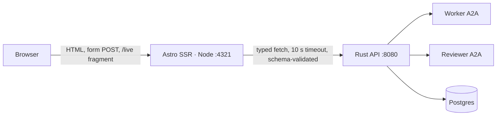

# Phase 4: Astro SSR portal and UI/UX (verification record)

Date: 2026-11-17 · Branch: `phase3/llm-integration` (uncommitted working tree) · Astro 7.4.12 ·
`@astrojs/node` 11.1.9 · Node 24.21.0 · Playwright 1.64.1 (Chromium 156) · axe-core 4.14.

Decision record: [ADR-002](ADR.md) (static build → server-rendered portal).

## 1. Phase 3 readiness (re-run before any change)

| Gate | Result |
|---|---|
| `cargo fmt --check`, `clippy -D warnings` | clean |
| `cargo test --workspace -- --test-threads=4` | **85 passed, 0 failed** (matches PHASE3.md) |
| Live Supabase / live hosted LLM | BLOCKED (unchanged; no credentials). Neither blocks the portal |

Verdict: PASS for frontend work. No backend file was changed in Phase 4 (`git diff backend` is empty).

## 2. Gap analysis (before)

| Area | Found | Action |
|---|---|---|
| Rendering | Static build served by Rust; client JS built every view with DOM calls | SSR portal, progressive enhancement (ADR-002) |
| Contracts | TS types without runtime validation; `error_code`/`failed_stage` (Phase 3) not shown | Zod schemas for every response; failure codes explained |
| Detail view | `?id=` query, table of runs, `<pre>` for Markdown | `/workflows/{id}`, timeline, rendered safe Markdown, findings by severity |
| States | Spinners and text only; no 404/503 statuses | Empty, error, not-found, in-progress, API-down states with correct HTTP codes |
| Design | Ad-hoc CSS variables | Token system (light + dark), component library |
| Tests | None for the frontend | 28 unit + 31 browser tests against the real stack |
| Backend capabilities | All needed endpoints exist (`GET/POST /api/workflows`, `GET /api/workflows/{id}`, `GET /api/agents`) | None invented. No search/filter: the API has none and a single-user MVP doesn't need it |

## 3. Design direction

Restrained developer-tool aesthetic: neutral canvas, white surfaces, 1px borders, one blue accent,
status colour only where it carries meaning (and always paired with text and an icon).

- **Tokens** (`src/styles/tokens.css`): colours (canvas, surface, borders, text tiers, accent,
  success/warning/error/info/neutral each as `-fg` for icons, `-text` for text, `-bg`, `-border`),
  focus ring, type scale 12/13/14/15/18/24 px, spacing 4/8/12/16/24/32/48, radii 6/10/full,
  control heights 40/32 px. Dark theme = one override block (`prefers-color-scheme`).
- **Type:** system UI stack; 14 px UI, 15 px / 1.65 for agent prose; monospace for IDs, A2A state, codes.
- **Contrast:** all used token pairs verified ≥ 4.5:1 (text) / ≥ 3:1 (icons, focus) in both themes by
  `tests/unit/contrast.test.ts`. The test caught and fixed 3 failing pairs (placeholder, dark accent buttons).

## 4. Information architecture

```
Sidebar (≥ 901 px) / top bar (≤ 900 px): Dashboard · Workflows
/                       Dashboard: in-progress notice · New task form · Recent workflows (5) | How it works + live agent status
/workflows[?before=]    History: rows (task, status, review, submitted) · Older / Newest cursor links
/workflows/{id}         Detail: header (badges, time) · outcome callout · [Progress timeline, Details] · Task · Worker draft · Reviewer verdict · A2A execution
/workflows/{id}/live    Partial HTML of the detail view, polled while active
/history, /workflow/?id Legacy redirects (301)
```

Detail outcome is one of four explicit callouts: *in progress* (info), *passed* (success),
*changes requested* (warning: "the workflow ran successfully") and *failed* (error, with the stable
`error_code`, failed stage, Rust's error text and recovery guidance). `needs_changes` is never shown as a failure.

Timeline `Queued → Worker → Reviewer → Completed|Failed` derives from `status`, the agent runs and
their timestamps only (`deriveTimeline`, unit-tested for every state, including "running before any
run is recorded" and "interrupted while queued"). No percentages.

## 5. Frontend HLD / LLD



```text
frontend/src/
├── middleware.ts                 CSP + security headers, no-store for HTML
├── lib/
│   ├── api-client.ts             transport: timeout, no redirects, 2 MiB cap, error envelope, schema check
│   ├── config.ts                 astro:env/server (API_ORIGIN, API_TIMEOUT_MS) → api singleton
│   ├── errors.ts                 ApiError (network|timeout|http|invalid_response), user-facing copy
│   ├── format.ts                 UTC/local time, durations
│   └── markdown.ts               markdown-it, html:false, safe link schemes, no images, nested headings
├── features/
│   ├── workflows/{api,schemas,present}.ts + components/ (TaskForm, WorkflowList, WorkflowBadge,
│   │                              WorkflowTimeline, ExecutionRecord, WorkflowDetailView)
│   └── agents/components/        AgentDirectory, DraftPanel, ReviewPanel
├── components/ui/                Button, Card, Callout, StatusBadge, EmptyState, ErrorState, CopyButton, Icon
├── components/navigation/        SideNav, PageHeader
├── layouts/                      BaseLayout, DashboardLayout
├── scripts/                      enhance.ts (local time, copy), task-form.ts, workflow-live.ts
└── pages/                        index, workflows/index, workflows/[id]/{index,live}, workflow/index, 404, 500
```

Key behaviours:

| Concern | Implementation |
|---|---|
| Submission | `<form method=post>` → `api.create(question, Idempotency-Key)` → 303 to detail. Key generated per render, regenerated when the text changes, kept after uncertain failures (timeout/5xx) so a retry replays instead of duplicating |
| Duplicate submits | Script disables the button + `aria-busy`; server-side the Idempotency-Key makes repeats return the same workflow |
| Error mapping | 422 `validation_failed` → field error (Rust's reason); 409 `workflow_active` → warning + link to running workflow; 413; `idempotency_key_mismatch` → reset; network/timeout → explicit "may not / was not submitted" |
| Live updates | Poll `/live` every 2 s while active; swap only when server `data-signature` changes; preserve focus; announce status via `aria-live`; pause when tab hidden; exponential backoff, stop after 6 failures with a message; stop at terminal state. `<noscript>` meta refresh fallback |
| Untrusted output | Agent text escaped by Astro; Markdown via `markdown-it` with raw HTML disabled, link allowlist (http/https/mailto/#), images off, `rel=nofollow noopener noreferrer`; DOM swaps use server HTML only |
| Security headers | CSP `default-src 'self'; script-src 'self'; style-src 'self'; …; frame-ancestors 'none'` (no inline code exists), nosniff, DENY, no-referrer, COOP, Permissions-Policy |
| CSRF | Astro `checkOrigin` (Sec-Fetch-Site/Origin); `allowedDomains` from `PORTAL_HOSTS` at build time |
| Secrets | None in the portal. `API_ORIGIN` is a server-only `astro:env` secret; `check-secrets.sh` scans `dist/client` for it and backend secret names |

## 6. Backlog (all done)

| ID | Item | Acceptance evidence |
|---|---|---|
| P4-01 | SSR adapter, env, middleware, CSRF | `api-down` + CSRF curl (403 cross-site, 303 same-origin); headers verified |
| P4-02 | Tokens + component library | contrast test; axe at 3 widths + dark |
| P4-03 | Typed client + schemas | `tests/unit/api-client.test.ts` (10) |
| P4-04 | Dashboard + submission | `dashboard.spec.ts` (7) |
| P4-05 | History + pagination | `history.spec.ts` (5) |
| P4-06 | Detail, timeline, live updates | `detail.spec.ts` (8), `present.test.ts` (9) |
| P4-07 | Safe Markdown | `markdown.test.ts` (7), XSS browser test |
| P4-08 | Accessibility, responsive, visual QA | `a11y-responsive.spec.ts` (7), screenshots reviewed |
| P4-09 | Tooling: dev.sh, e2e stack, CI unit tests, secret check | `dev.sh` smoke run; negative secret test |

## 7. Testing evidence

```bash
cd frontend
npm test            # 28 unit tests (node --test): pass 28, fail 0
npm run build       # astro check: 0 errors, 0 warnings, 0 hints; build complete
npm run test:e2e    # 31 Playwright tests (see run history below)
../scripts/check-secrets.sh   # secret check: OK (negative test with a planted API_ORIGIN fails as expected)
```

Run history: 31/31 passed on a warm stack (2.2–2.6 min). The final cold run on the current code
was **30/31**: `reduced motion stops spinner animation` timed out because the host was saturated
(load average 117; a single `GET /api/workflows` took 10 s, hitting the portal's 10 s API timeout, so
the page correctly showed its "API took too long" state instead of the timeline). Re-run on an idle
host to confirm 31/31. Cold runs on this host also exposed two genuine issues, now fixed: focus after a
server-side form error is set with `autofocus` (no script race), and real-workflow tests wait on agent
latency instead of a fixed 10 s.

E2E runs the **real stack**: `scripts/e2e-stack.sh` creates a scratch database `a2a_e2e`, runs
`api migrate`, starts both A2A agents (mock inference) and the API on ports 18080/19101/19102;
Playwright starts the built portal twice (one pointed at a closed port for API-down states).
States the deterministic mock can't produce (hostile/long output, specific failures, a workflow held
in `running`) are seeded directly into the scratch DB; the portal still reads them through Rust.

| Required check | Test(s) | Result |
|---|---|---|
| Task submission | `submits a task and lands on its live detail page` (real Worker → Reviewer run) | PASS |
| Form validation | client (`validates the question…`), server/no-JS (`server-side validation works without JavaScript`, Rust 422) | PASS |
| Duplicate prevention | `a double submit creates exactly one workflow`, `shows progress while submitting and blocks a second submit` | PASS |
| History retrieval, pagination | `lists workflows newest first…`, `pages through history with the API cursor` (30 rows, µs cursor) | PASS |
| Detail retrieval | `a completed workflow with needs_changes…`, `a passed review…`, `a failed workflow…` | PASS |
| Polling + terminal stop | `live updates follow the real backend states…` (Worker → Reviewer → Completed without reload; 0 polls in the 5 s after terminal) | PASS |
| Worker/Reviewer display | as above, findings sorted by severity, counts | PASS |
| API error handling | `api-down.spec.ts` (4): degraded dashboard, not-submitted alert with focus, 503 pages with retry, no internals leaked | PASS |
| 409 busy | `explains that another workflow is running` | PASS |
| Navigation | active states, legacy redirects, 404s | PASS |
| Keyboard | skip link, tab order, visible focus, focusable scroll regions | PASS |
| XSS-safe rendering | `agent output is rendered as inert text` (script/img/svg/iframe/javascript: in every field) + unit tests | PASS |
| Responsive | axe + no horizontal overflow at 375/768/1440 on 6 pages; long-output test (20k chars, 400-char token, wide code and table) | PASS |
| Accessibility (automated) | axe WCAG 2.0/2.1/2.2 A/AA + best-practice: 0 violations, light and dark | PASS |
| Reduced motion, touch targets | spinner animation disabled; all controls ≥ 24 px (WCAG 2.5.8) | PASS |

Defects found by these checks and fixed: 3 contrast token pairs; brand link lost its name < 380 px;
agent `##` headings skipped a level (now renumbered from h4); horizontally scrollable code blocks/tables
weren't keyboard-focusable; Astro's Origin check rejected same-origin posts without `allowedDomains`;
sidebar background ended at viewport height; missing space after "Submitted"; list padding misaligned.

Performance (measured, no Lighthouse run): no framework runtime; three client scripts total 5.0 KB
(2.7 KB gzipped; largest 1.9 KB), all CSS 34 KB (6 KB gzipped); dashboard SSR responds in < 1 ms of portal time plus two parallel
API calls (~0.2 s each locally, dominated by Agent Card discovery). One poll per 2 s while active, none
when idle, hidden or terminal. Lighthouse scores: **UNVERIFIED** (not run).

## 8. Quality gate

| Criterion | Result |
|---|---|
| Dashboard task submission works | PASS |
| Workflow history loads from Rust | PASS |
| Workflow details show correct data | PASS |
| Worker and Reviewer results display correctly | PASS |
| Error and loading states work | PASS |
| No unsupported endpoints assumed | PASS |
| Consistent design system | PASS |
| Clear hierarchy on all three pages | PASS (visual review of 20 screenshots) |
| Intuitive navigation | PASS |
| Consistent typography and spacing | PASS |
| Forms give clear feedback | PASS |
| Responsive layouts verified | PASS (375/768/1440, Chromium only) |
| Long agent responses readable | PASS |
| No major layout/accessibility defects | PASS (automated + visual); screen-reader walkthrough UNVERIFIED |
| Astro + TypeScript checks | PASS |
| Production build | PASS |
| Integration and browser tests | PASS with caveat: 30/31 on the final cold run (1 host-load timeout), 31/31 warm; E2E not in CI |
| No known critical frontend security issues | PASS |
| No private credentials in browser assets | PASS |
| Maintainable component boundaries | PASS |

**Phase 4: CONDITIONAL PASS.** All functional, visual and technical criteria pass with evidence.
Conditions: (1) browser coverage is Chromium only (Firefox/Safari unverified); (2) no manual
screen-reader pass; (3) E2E needs Docker + Rust locally and isn't wired into CI; (4) the portal has no
authentication. It is for private/operator use only until P1 adds access control at the proxy.

## 9. Remaining limitations

- **No authentication or authorization** anywhere (unchanged from the PRD's private-pilot scope). Do not expose the portal publicly.
- `PORTAL_HOSTS` is a build-time setting; a new public hostname needs a rebuild.
- The `@astrojs/node` adapter logs "Enabling sessions with filesystem storage"; sessions are unused.
- Local times are rendered in UTC on the server and converted by script; without JavaScript, times show in UTC.
- Rust still contains the optional static-serving code path (`FRONTEND_DIR`); unused, and removable later.
