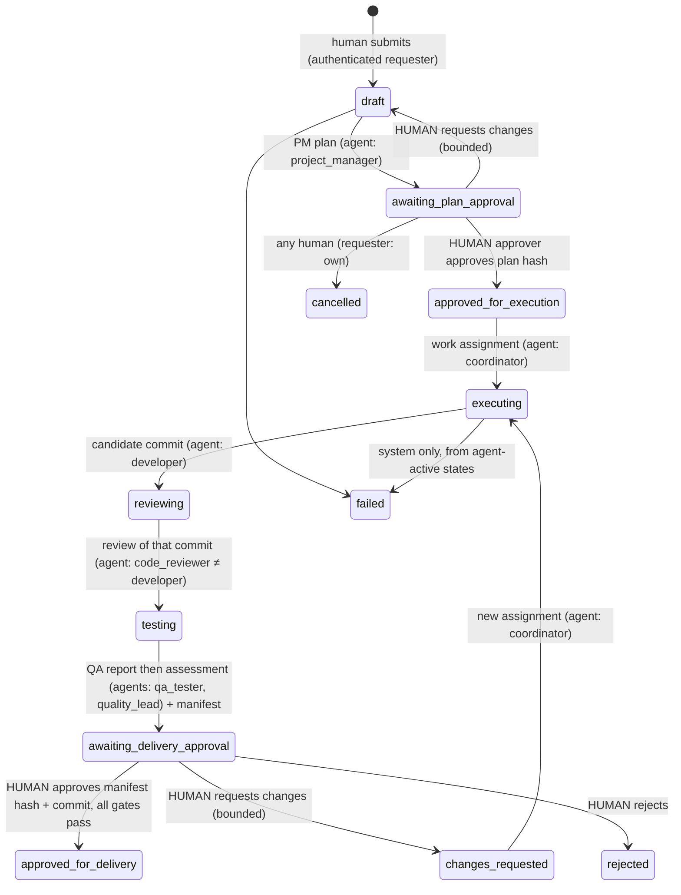

# Phase 6: multi-agent engineering collaboration and human-in-the-loop approval (verification record)

Date: 2026-11-17 · Branch: `phase5/agent-e2e-workflow` (HEAD `3e94306` + uncommitted Phase 5 changes + Phase 6 increment, nothing committed) ·
Rust 1.100.0 · Postgres 17 (local) · host load average 130–150 on 8 cores for the whole session.

**Bottom line.** This session delivered milestones **M1–M3** and the logic of **M7**, verified with
deterministic simulation (test Mode A) against real Postgres and real HTTP. **M4 (real provider), M5 (isolated
code execution), M8 (portal), M9 and Mode B/C are not started.** Human approvals are implemented but
**BLOCKED in production wiring**: no identity provider is configured, so `api serve` answers 503
`auth_unavailable`. Nothing below claims real multi-provider interoperability.

## 1. Starting point (Phase 5 inspection)

- Phase 5 verdict: CONDITIONAL PASS; its changes (engine failure-recording retry, frontend dependency and
  body-limit fixes, CI `npm audit`) are still **uncommitted** in this working tree. Phase 6 builds on top of them
  and does not modify them.
- P0 Worker → Reviewer workflow: verified (86 Rust + 31 browser tests in Phase 5). Preserved untouched:
  Phase 6 adds new tables (`eng_*`), a new crate and a new module; the P0 tables, engine and routes are unchanged.
- Smallest viable increment chosen: the parts every later milestone depends on and that can be verified
  without credentials: state machine, role/tool policy, artifact contracts, persistence + audit, approval engine,
  deterministic orchestration, and the mandatory negative tests.

## 2. Architecture review and ADR / PRD updates (M1)

- `docs/ADR.md` **ADR-003** (new): additive subsystem in the modular monolith, no new infrastructure,
  roles as policy, A2A as transport only, `RoleAgent` adapter trait, no simulation fallback, server-side identity.
- `A2A_PRD.md` **§9** (new): the PRD changes Phase 6 needs (it moves "extra agents", "tool execution" and
  "automated repository edits" from out-of-scope into a gated extension; adds human authority, identity,
  delivery boundary, execution isolation, evidence and budget requirements).

## 3. Backend module design

| Unit | Owns | I/O |
|---|---|---|
| `crates/engineering` (new) | `state` (12 states, events, actor rules, budgets, recovery rule), `roles` (6 roles, closed tool set, check allowlist by id, path scope, branch namespace, separation of duties), `artifacts` (8 typed contracts, canonical-JSON SHA-256), `gates` (mandatory delivery gates) | none |
| `apps/api/src/eng/store.rs` | Locked, version-guarded transitions + audit in one transaction; runs with duplicate-execution guard; append-only artifacts; restart recovery | Postgres |
| `eng/orchestrator.rs` | Runs stages in role order until a human gate; deadline per stage; bounded retry (only unavailable/timeout); validates every output before handoff; builds the delivery manifest | adapters, Postgres |
| `eng/approval.rs` | Human decisions: authorization, version, artifact-hash + commit binding, gates, idempotency | Postgres |
| `eng/auth.rs` | `Authenticator` trait; production impl `Disabled` | — |
| `eng/agents.rs` / `eng/sim.rs` | Provider adapter trait; deterministic simulated agents (provider `simulation`, test-only wiring) | — |
| `eng/routes.rs` | `/api/eng/{status,workflows,workflows/{id},workflows/{id}/decisions}` (also under `/api/v1/eng`) | — |
| `migrations/20261117000003_engineering_workflows.sql` | 5 tables, CHECKs, append-only triggers, least-privilege grants, RLS, Supabase role revokes | — |

## 4. Workflow state machine

Guards (`engineering::state::next`): one actor kind per event; human gates need `HumanRole::Approver`
(no agent role, not the system); terminal states are final; `fail` is impossible at a human gate (nothing runs);
each accepted transition increments `version`. Agent-run status is stored separately (`eng_agent_runs`).
**Recovery:** agent-active states → `failed/interrupted`, running runs → `interrupted` (no replay, as P0);
`awaiting_*` preserved exactly (version, hashes). Budgets: plan revisions, delivery revisions, agent runs
(defaults 2/2/24, snapshotted per workflow, CHECK-enforced in the DB too).

## 5. Agent and artifact contracts

All contracts: `deny_unknown_fields` (no place for hidden reasoning), bounded text, schema version 1,
hash = `sha256(kind:version:canonical_json)`. Agent output is validated before the next agent sees it.

| Kind | Producer | Key rules |
|---|---|---|
| `requirements_plan` | PM | ≥1 deliverable, unique `AC-n` criteria, steps, repo-relative `scope` |
| `work_assignment` | Coordinator | scope ⊆ approved plan scope; criteria ⊆ plan; checks from allowlist; full base SHA |
| `code_candidate` | Developer | full SHAs, commit ≠ base, base = assigned base, branch = `agent/<workflow>/candidate`, every changed file in scope, patch SHA-256 |
| `review_report` | Reviewer | commit = candidate; conclusion consistent with findings (high/critical ⇔ `blocking_findings`); reviewer ≠ developer |
| `qa_report` | QA | commit = candidate; commands by check id with exit codes; per-criterion status + evidence; QA ≠ developer |
| `quality_assessment` | Quality Lead | commit = candidate; `ready / changes_required / blocked` (advice only) |
| `delivery_manifest` | orchestrator | ids + hashes of plan, assignment, candidate, review, QA, assessment for one commit |
| `approval_decision` | human only | written by the approval engine; agents cannot submit it (contract refuses) |

Every stored artifact has id, workflow id, producer kind/id, provider/model (agents), created_at, schema
version, content, content hash, commit SHA where applicable. Each run records role, agent id, provider, model,
attempt, correlation id, A2A task id (when A2A), token usage (when reported).

## 6. Human approval data model and security/permission model

`eng_approvals`: id, workflow id, gate, decision, authenticated approver id, approver role, identity issuer,
comment, reviewed commit SHA, artifact hash (plan hash or manifest hash), workflow version, idempotency key,
request hash, timestamp. `UNIQUE(workflow_id, workflow_version)` (one decision per version) and
`UNIQUE(workflow_id, idempotency_key)`; CHECKs tie gate ↔ decision ↔ required bindings ↔ approver role.

| Control | Enforcement |
|---|---|
| Identity from server only | `Authenticator` trait; body is `deny_unknown_fields` with no identity field (spoof → 422) |
| No IdP → no approvals | `Disabled` authenticator in `api serve` → 503 `auth_unavailable`; `/api/eng/status` reports `approvals_enabled:false` |
| AI ≠ approval | State machine actor rules; reviewer/QL produce "evidence"/"recommendation" types, never "approved" |
| Stale / conflicting / forged | Row lock + `expected_version`; per-version unique; hash + commit binding; idempotency with request hash |
| Reapproval after change | New candidate ⇒ new manifest hash and version ⇒ old decision refused |
| Failed stages never approved | Mandatory gates (candidate, review for commit, no high/critical, QA for commit, all checks exit 0, all criteria verified, assessment for commit, not `blocked`) |
| Tool requests untrusted | Closed `Tool` enum (no push/merge/approve/deploy/secret/shell); checks by id → fixed argv; path scope with traversal / `.git` refusal; branch namespace |
| Audit integrity | Append-only trigger on artifacts, approvals, audit (binds the table owner, blocks TRUNCATE); runtime role has SELECT/INSERT only |
| Duplicate execution | Partial unique index: one live/completed run per `(workflow, role:version)` |

**Not yet enforced (needs M5):** tool requests are *reported* by the adapter and checked after the fact; with
simulation nothing executes. A real Developer/QA adapter must run inside a sandbox that enforces the same
policy *before* execution (filesystem scope, no network except an allowlisted registry mirror, CPU/memory/time
limits, output caps, secret redaction, no credentials). Isolation model to assess in M5: containers alone are
not adequate for untrusted code from an LLM; candidates are a microVM (Firecracker/gVisor) or a disposable VM per run.

## 7. Provider integration matrix

| Provider | Kind | Auth / tools / structured output / approval hooks / sessions / cancel / usage / licensing | Status |
|---|---|---|---|
| Simulation (`eng::sim`) | deterministic in-process | n/a | **Implemented, test-only** |
| Claude Code / Claude Agent SDK | coding-agent runtime | not inspected this session | NOT STARTED (M4 candidate) |
| OpenAI Codex | coding-agent runtime | not inspected | NOT STARTED |
| Gemini CLI | coding-agent CLI | not inspected | NOT STARTED |
| Grok (xAI API) | LLM API, **not** a coding-agent runtime | not inspected | NOT STARTED |

No provider documentation was verified and no provider credentials exist in this environment (Phase 5 also had
none), so no capability is claimed. M4 must first read each SDK's current docs and record the columns above.

## 8. Test results (Mode A, real Postgres, real HTTP for the API)

Commands: `cargo test -p engineering` (25 unit tests) and `cargo test -p api --test phase6` (21 integration tests).

| # | Test (§12 / §13) | Evidence | Result |
|---|---|---|---|
| E2E-1 | Approved flow over HTTP | `approved_flow_over_http`: runs in order PM → Coordinator → Developer → Reviewer → QA → QL, all `provider=simulation`; pause at plan and delivery; all gates pass; approval row has `alice` / `approver` / `test-idp`, commit SHA, manifest hash; audit has human actor | PASS |
| E2E-2 | Changes-requested flow | `changes_requested_flow_requires_reapproval`: new candidate SHA + new manifest; old version → `Stale`; old SHA or old manifest at new version → `Mismatch`; re-approval succeeds; 2 candidates, 2 manifests | PASS |
| E2E-3 | Rejection | `delivery_can_be_rejected` | PASS |
| N1 | Unauthorized user approves | no token 401; forged token 401; requester 403; `approver_id` in body 422; no IdP 503 `auth_unavailable`; no approval row written | PASS |
| N2 | AI agent approves delivery | every agent role and the system → `Unauthorized`; QL requesting `approve_delivery` tool → workflow `failed/tool_not_permitted` | PASS |
| N3 | Reviewer reviews own patch | same agent id as developer → `failed/policy_violation`, no review artifact | PASS |
| N4 | Candidate changes after approval | artifact insert into approved workflow refused (`Terminal`); UPDATE/DELETE/TRUNCATE of artifacts/approvals/audit refused **as table owner**; `a2a_app` lacks UPDATE/DELETE | PASS |
| N5 | Provider unavailable | 2 failed attempts `agent_unavailable` → workflow failed, no candidate artifact (no mock success); 1 transient failure → recovered by retry | PASS |
| N6 | Malformed output | PM output with unknown fields (`reasoning`) → `artifact_invalid`, no artifact stored | PASS |
| N7 | Unauthorized tool | developer `git_push` → `tool_not_permitted` | PASS |
| N8 | Execution budget | `max_agent_runs=3` → `budget_exceeded` at the 4th stage, `agent_runs=3` | PASS |
| N9 | Restart during human approval | `recover_interrupted` → 0 changes, version and manifest hash identical, decision accepted afterwards; crash mid-developer → `failed/interrupted`, run `interrupted` | PASS (simulated crash: task abort + recovery call, not a killed process) |
| N10 | Conflicting approvers | concurrent approve (alice) / reject (carol) → exactly one recorded, the other `Stale`/`Transition` | PASS |
| N11 | QA for another commit | `candidate_mismatch`, no QA artifact | PASS |
| N12 | Protected branch | developer reports `main` → `policy_violation` | PASS |
| N13 | Retry duplicates execution | 2–3 concurrent `advance` loops → each role's agent called exactly once, 6 runs | PASS |
| N14 | Forged / stale request | wrong hash → `Mismatch`; old version → `Stale`; wrong gate → `Transition`; same key+body → replay (same id); same key, other body → `IdempotencyConflict` | PASS |
| + | Stage timeout | hanging reviewer, 300 ms deadline → 2 attempts → `agent_timeout` | PASS |
| + | Failed evidence never approvable | failing QA and high finding → approve `GatesFailed`, reject works | PASS |
| + | Plan-changes loop, cancel by requester | | PASS |
| + | Every failure code accepted by the DB CHECK | | PASS |

Mutation check: disabling the gate check in `approval.rs` turns `failed_evidence_cannot_be_approved` red; restored.

Regression (full workspace, `cargo fmt --check`, `clippy -D warnings`, `cargo test --workspace`): see §8a.

### 8a. Full regression

| Command | Outcome |
|---|---|
| `cargo fmt --all -- --check` | PASS |
| `cargo clippy --workspace --all-targets --locked -- -D warnings` | PASS (after one `type_complexity` fix in `tests/phase6.rs`; it was a lint-only change, so the tests were not re-run) |
| `cargo test --workspace --locked --no-fail-fast -- --test-threads=4` | **132 passed, 0 failed**: the 86 existing tests are unchanged and all pass (P0 `workflow.rs` 25, `phase3.rs` 17, agents, runtime, contracts), plus 25 `engineering` unit tests and 21 `phase6` integration tests |

The P0 Worker → Reviewer workflow still passes its whole suite, so it is preserved.

## 9. Quality gate (§15)

| Criterion | Result | Basis |
|---|---|---|
| Multiple specialized agents in one workflow | PASS (simulation only) | E2E-1; six roles, distinct identities |
| Tasks and artifacts correctly correlated | PASS (simulation) | run ↔ artifact ↔ commit ↔ manifest; correlation id per run |
| A2A communication over real transport | **UNVERIFIED** | Role agents not yet A2A; P0 A2A unchanged and verified in Phase 5 |
| Handoffs use validated contracts | PASS | N6, N11, contract unit tests |
| Coding execution is isolated | **BLOCKED / NOT STARTED** | M5; no execution happens yet |
| Code review and QA evidence reproducible | **UNVERIFIED** | Evidence is simulated, not produced by real checks |
| Human approvals authenticated and authorized | **BLOCKED** | Logic PASS (N1, N10, N14) with a test authenticator; no IdP configured |
| Agents cannot approve their own delivery | PASS | N2, N3 |
| Humans can inspect the workflow | PARTIAL | `GET /api/eng/workflows/{id}` returns runs, artifacts, gates, approvals, audit; portal (M8) not built |
| Restart recovery preserves workflow + approval state | PASS (in-process) | N9; a killed-process test like Phase 3's is still to add |
| Failed stages cannot become approved deliveries | PASS | gates + N4, failed-evidence test |
| Security and integration regression tests pass | PASS (Mode A + existing suites) | §8a; Mode B/C not run |

**Overall Phase 6: NOT COMPLETE.** M1–M3 PASS; M7 logic PASS / production BLOCKED (IdP); M4, M5, M6 (real
evidence), M8, M9, M10 NOT STARTED.

## 10. Remaining gaps, cost considerations, production limitations

1. **M4 – first real provider.** Inspect docs, pick one coding-agent runtime (Claude Agent SDK is the natural
   first: same vendor as the existing LLM client), implement `RoleAgent` for it, Mode B contract tests with an
   HTTP test double (auth failure, invalid response, unsupported capability, timeout, usage accounting, no fallback).
2. **M5 – isolation.** Real Git worktree per workflow on a disposable sandbox; run allowlisted checks there;
   compute candidate SHA/patch hash from the actual repo, not from the agent's claim; enforce tool policy before
   execution; limits and secret redaction. Assess microVM vs container.
3. **M7 – IdP.** OIDC JWT verification (issuer, audience, expiry, JWKS rotation) as an `Authenticator`; map
   groups → `requester`/`approver`. Until then approvals stay BLOCKED.
4. **M8 – portal.** Dashboard, detail timeline, review/QA evidence, approval review with confirmation, audit
   history, using `/api/eng` data only. The portal must forward the user's session credential; it must never
   mint identity.
5. **A2A for roles.** Expose remote role agents through the pinned SDK with Agent Card validation (reuse
   `api::a2a::Gateway`), cancellation on deadline, artifact extraction into these contracts.
6. **Cost.** Budgets bound runs, not money: add per-workflow token/cost caps once a provider reports usage;
   a full pass is ≥ 6 model runs (more with retries/revisions; defaults allow up to 24).
7. Known limits: stage timeout cancels by dropping the future (A2A adapters must also send `CancelTask`);
   a crash mid-stage still discards the in-flight agent's work (as in P0); one orchestrator per database (the
   existing instance lock covers both subsystems).

Nothing was committed, pushed, or deployed. GitOps/production deployment was not started.
